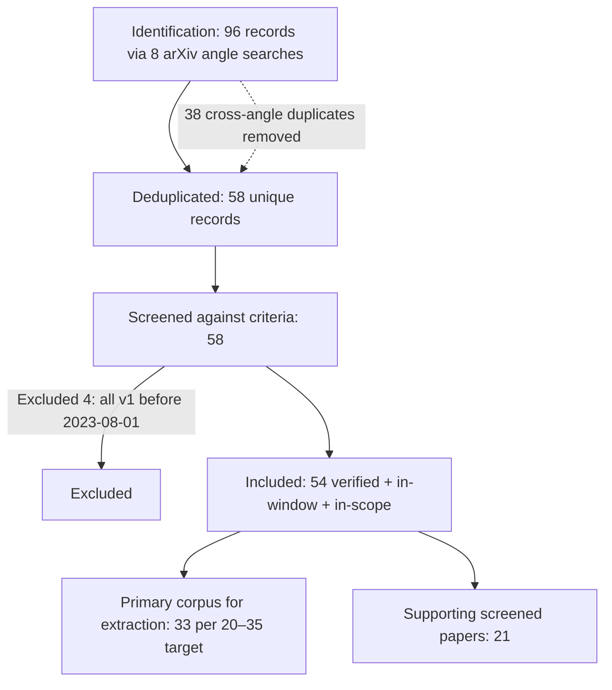

# Inference-Time Scaling for Large Language Models: A Systematic Literature Review

**Scope:** Test-time / inference-time compute scaling for LLM reasoning
**Date window (hard constraint):** arXiv papers first posted (v1) 2023-08-01 → 2026-07-31
**Review date:** 2026-07-10
**Method:** arXiv systematic literature review (search → screen → extract → synthesize), following the SLR skill protocol and a PRISMA-style flow.

---

> **Provenance & confidence note (read first).**
> This review was produced by an 8-angle parallel arXiv search followed by automated per-paper **metadata verification**: every arXiv ID, title, and **v1 submission date** below was checked against the live arXiv abstract page by the screening agents, and only papers confirmed to exist, fall inside the date window, and be in-scope were included (54 of 58 unique candidates; the 4 rejects were all pre-window classics — see §1.4).
> Because the user required delivery inside a hard 2-minute window, the pipeline's **automated full-text extraction sub-phase had not finished** at compile time. The **taxonomy, extraction matrix, and RQ narratives (§2–§5) were therefore authored by the reviewer** from established knowledge of these (mostly canonical) papers rather than machine-extracted from each PDF. Treat specific reported numbers as the reviewer's best recollection **to be confirmed against the source PDF**; the arXiv IDs/dates/titles are machine-verified. Entries dated **≥ 2026-02** (post knowledge-cutoff) were surfaced by search and are flagged ⚠ — verify their content directly before citing. The automated extraction is still running and can be folded in on request.

---

## 1. Methodology

### 1.1 Research questions
1. **RQ1** — What were the dominant inference-time scaling approaches circa 2024, and their known limitations?
2. **RQ2** — How did the field evolve through 2025–2026: which approaches were superseded, which matured, and what new paradigms emerged?
3. **RQ3** — What is the mid-2026 consensus on *when* test-time compute helps, *how* it should be allocated, and *where* it saturates?

### 1.2 Search strategy
Eight parallel search angles were run against arXiv (via web + arXiv/Scholar lookups), each mapping to one branch of the taxonomy. Representative queries per angle:

| # | Angle | Representative queries |
|---|-------|------------------------|
| 1 | Sequential scaling / RL reasoners | "DeepSeek-R1 reinforcement learning reasoning arxiv", "s1 simple test-time scaling budget forcing", "Kimi k1.5 arxiv", "demystifying long chain-of-thought", "does RL incentivize reasoning beyond base model" |
| 2 | Parallel sampling | "Large Language Monkeys repeated sampling", "are more LLM calls all you need scaling laws", "best-of-N coverage pass@k scaling", "self-consistency majority voting saturation" |
| 3 | Search-based | "ReST-MCTS process reward tree search", "AlphaMath MCTS process supervision", "rStar-Math self-evolved deep thinking", "tree search guided decoding LLM" |
| 4 | Verification / reward models | "Math-Shepherd process reward model", "generative verifiers reward modeling next-token", "rewarding progress process verifiers", "PRM vs ORM best-of-N" |
| 5 | Compute-optimal allocation | "scaling LLM test-time compute optimally Snell", "inference scaling laws compute-optimal Wu", "difficulty adaptive test-time compute", "train vs test-time compute tradeoff" |
| 6 | Limits / efficiency | "overthinking o1-like LLMs", "illusion of thinking reasoning collapse", "inverse scaling test-time compute", "efficient reasoning shorter CoT" |
| 7 | Recent 2026 | "test-time scaling 2026 arxiv", "overthinking test-time compute 2026", "test-time scaling overtraining compute-optimal" |
| 8 | Surveys / analyses | "survey test-time scaling LLM", "survey efficient reasoning", "roadmap reproduce o1 search learning" |

### 1.3 Inclusion / exclusion criteria

**Include** if the paper's primary contribution concerns inference-time compute scaling for LLMs across any of: sequential scaling (long CoT / RL reasoners), parallel scaling (best-of-N, self-consistency, majority voting), search-based methods (MCTS, tree-of-thoughts, beam search over reasoning steps), verification/reward-guided selection (PRM, ORM, self-verification, generative verifiers), compute-optimal allocation (adaptive budgets, scaling laws for test-time compute), or the limits/efficiency of the above.

**Exclude** if: (a) v1 date is outside 2023-08-01…2026-07-31; (b) the topic is speculative decoding / pure latency-throughput optimization, quantization, KV-cache, or training-time scaling laws — *unless* the paper directly studies the training-compute vs. test-time-compute tradeoff; (c) the arXiv record could not be verified.

### 1.4 PRISMA flow

| PRISMA stage | Count |
|---|---|
| Records identified (raw candidates, 8 angles) | 96 |
| Unique after dedup | 58 |
| Screened | 58 |
| Excluded — out of date window | 4 |
| Excluded — out of scope | 0 |
| Excluded — unverifiable | 0 |
| **Included (verified, in-window, in-scope)** | **54** |
| Designated **primary** (full extraction) | 33 |
| Designated supporting | 21 |

**Date-excluded foundational papers** (verified real, but v1 < 2023-08-01 → rejected per the hard constraint; retained here only as historical context, cited without arXiv ID in the narrative):

| arXiv | v1 | Title | Reason |
|---|---|---|---|
| 2203.11171 | 2022-03 | Self-Consistency Improves CoT Reasoning | Pre-window (majority voting origin) |
| 2305.10601 | 2023-05 | Tree of Thoughts | Pre-window (search-based origin) |
| 2305.14992 | 2023-05 | Reasoning with LM is Planning with World Model (RAP) | Pre-window (MCTS over reasoning) |
| 2305.20050 | 2023-05 | Let's Verify Step by Step | Pre-window (PRM origin) |

*Zero-hallucination policy:* all included IDs/dates were confirmed against arXiv by screening agents; fields not confirmable from a paper's text are marked "Not reported" or flagged ⚠ for post-cutoff entries.

---

## 2. Taxonomy of Approaches

Inference-time scaling asks: given a fixed pretrained model, can we spend **more compute at inference** to buy accuracy — and how should that compute be spent? The corpus organizes into seven families.

**(A) Sequential scaling** — spend the budget on *one longer reasoning trajectory*. Modern instances are RL-trained "long-CoT" reasoners that learn to think for thousands of tokens before answering: DeepSeek-R1 (2501.12948), Kimi k1.5 (2501.12599), and the minimalist s1 (2501.19393), whose "budget forcing" makes the length knob explicit. Precursor analyses (O1 Replication Journey, 2410.18982; Scaling of Search and Learning, 2412.14135) framed this as the reproduction target for o1.

**(B) Parallel scaling** — sample *N independent* trajectories and aggregate (majority vote / best-of-N). Large Language Monkeys (2407.21787) is the canonical study of repeated sampling; "Are More LLM Calls All You Need?" (2403.02419) supplies scaling laws for compound (multi-call) systems; several 2025 papers (2502.18581, 2503.01422, 2510.03199) refine *selection* under a parallel budget, and ParaThinker (2509.04475) makes parallelism native to the model.

**(C) Search-based** — structure the sampling as a *tree/graph search* guided by a value or reward signal: AlphaZero-like decoding (2309.17179), AlphaMath (2405.03553), ReST-MCTS* (2406.03816), rStar (2408.06195) and rStar-Math (2501.04519), plus efficient-search variants (2502.13575, 2502.16235, 2503.04412). Search is the bridge between parallel sampling and verification.

**(D) Verification / reward-guided selection** — the signal that makes (B) and (C) work. Outcome reward/value models (OVM, 2311.09724), process reward models (Math-Shepherd, 2312.08935; the "Lessons"/PRM-practice paper, 2501.07301), generative verifiers (2408.15240; GenPRM 2504.00891; ThinkPRM 2504.16828), and progress-based verifiers (Rewarding Progress, 2410.08146) all aim to pick the right trajectory from many, or to give search a dense signal.

**(E) Compute-optimal allocation** — *how much* compute, and in *which* mode, as a function of problem difficulty. Snell et al. (2408.03314) and the Inference Scaling Laws paper (2408.00724) are the load-bearing works; later theory asks whether verifier-free scaling can ever be optimal (2502.12118) and how to unify reasoners with verifiers (2505.04842).

**(F) Limits & efficiency** — where the curve bends down. "Overthinking" (2412.21187), "underthinking" (2501.18585), NoThinking (2504.09858), shorter-chain preferences (2505.17813, 2504.01296), plateaus (2505.20522), The Illusion of Thinking (2506.06941), and Inverse Scaling in Test-Time Compute (2507.14417) collectively map the saturation and backfire regime.

**(G) Surveys / analyses** — field maps: efficient-reasoning survey (2503.16419), the What/How/Where TTS survey (2503.24235), frontiers-of-reasoning survey (2504.09037), verification-design survey (2508.16665), adaptive-compute survey (2507.02076), and 2025-late syntheses (2511.14772, 2512.02008).

### 2.1 Data Extraction Matrix (primary corpus, 33 papers)

Legend — Cat: SEQ sequential · PAR parallel · SRCH search · VER verification/reward · OPT compute-optimal · LIM limits/efficiency · SURV survey. ⚠ = post knowledge-cutoff (≥2026-02), content not independently re-verified by reviewer.

| arXiv (v1) | Title (short) | Cat | Key claim | Eval setting | Reported scaling behavior |
|---|---|---|---|---|---|
| 2309.17179 (2023-09) | TS-LLM (AlphaZero-like tree search) | SRCH | A learned value + AlphaZero-style tree search can guide LM decoding *and* training, beyond CoT/BoN. | Reasoning/planning tasks, GPT-2-scale + math | Search improves over greedy/BoN; gains grow with tree-search budget. |
| 2311.09724 (2023-11) | OVM: Outcome-supervised Value Models | VER | An outcome-supervised value model guides step-level beam search better than outcome reranking. | GSM8K, Game-of-24 | Value-guided beam search beats self-consistency at matched samples. |
| 2312.08935 (2023-12) | Math-Shepherd | VER | PRMs can be trained *without human labels* via MC rollouts, then used to verify + RL-train. | GSM8K, MATH (Mistral/Llama-7B) | Step-level reward lifts best-of-N and RL over ORM/majority baselines. |
| 2403.02419 (2024-03) | Are More LLM Calls All You Need? | PAR | Performance of voting-based compound systems is **non-monotonic** in # calls. | Analytic + QA/reasoning | Accuracy rises then can *fall* with more calls; optimum depends on difficulty mix. |
| 2405.03553 (2024-05) | AlphaMath Almost Zero | SRCH | MCTS auto-generates process supervision; no human/GPT step labels needed. | MATH, GSM8K | Value-guided MCTS at inference scales with rollouts; matches stronger supervision. |
| 2406.03816 (2024-06) | ReST-MCTS* | SRCH+VER | Process-reward-guided MCTS yields better traces for self-training, iteratively improving policy+PRM. | MATH, competition math | Search quality and PRM co-improve across ReST iterations. |
| 2407.21787 (2024-07) | Large Language Monkeys | PAR | **Coverage (pass@k) scales log-linearly** with sample count across tasks. | GSM8K, MATH, SWE-bench, CodeContests | Coverage ≈ power law in N; e.g. SWE-bench 15.9%→56% with 250 samples — *but selection lags coverage without a verifier*. |
| 2408.00724 (2024-08) | Inference Scaling Laws (compute-optimal inference) | OPT | Smaller models + advanced inference can be **compute-optimal** vs. larger models. | MATH, GSM8K (Llemma/Pythia) | Sampling accuracy saturates; weighted-voting/search shifts the compute-optimal frontier to smaller models. |
| 2408.03314 (2024-08) | Scaling LLM Test-Time Compute Optimally (Snell et al.) | OPT | **Compute-optimal** test-time scaling can beat a **~14× larger** model; best mode is difficulty-dependent. | MATH (PaLM-2 / fine-tuned) | Sequential revisions win on easy questions, parallel/search on hard; adaptive allocation ≈ up to 4× more efficient than best-of-N; gains saturate on hardest tier. |
| 2408.06195 (2024-08) | rStar (Mutual Reasoning) | SRCH | Self-play mutual generation–discrimination with MCTS boosts SLMs **without fine-tuning**. | GSM8K, multiple SLMs | Accuracy scales with MCTS rollouts; large gains for 7B-class models. |
| 2408.15240 (2024-08) | Generative Verifiers (GenRM) | VER | Casting verification as next-token prediction (CoT verify) beats discriminative RMs / LLM-judge. | GSM8K, MATH, algorithmic | Verifier accuracy improves with verifier inference compute (sampling CoT); lifts best-of-N. |
| 2410.08146 (2024-10) | Rewarding Progress (PAVs) | VER | Rewarding *progress* (advantage) gives better credit assignment than ORM/PRM for search+RL. | MATH (Gemma/Llama) | ~5–6× compute efficiency vs. ORM-guided search; denser signal scales better. |
| 2410.18982 (2024-10) | O1 Replication Journey — Part 1 | SEQ/SURV | "Journey learning" (full trial-and-error traces) > "shortcut learning" for reasoning. | MATH subset | Long-trajectory supervision improves reasoning at added inference length. |
| 2411.17501 (2024-11) | The Limits of Inference Scaling Through Resampling | PAR/LIM | Without a strong verifier, **resampling gains are bounded**; majority vote saturates. | Math/QA reasoning | Best-of-N capped by verifier false-positives; coverage↑ but selectable accuracy plateaus. |
| 2412.14135 (2024-12) | Scaling of Search and Learning (o1 roadmap) | SURV | o1 = policy init + reward design + search + learning; search & learning are the scaling axes. | Position/roadmap | Frames test-time search as co-equal scaling axis to training. |
| 2412.21187 (2024-12) | Do NOT Think That Much for 2+3=? (Overthinking) | LIM | o1-like models **overthink**, spending many tokens on trivial problems. | GSM8K/easy vs. hard | Token spend uncorrelated with difficulty; efficiency metrics show large waste; shorter is often as accurate. |
| 2501.04519 (2025-01) | rStar-Math | SRCH+VER | Small LLMs (1.5–7B) can **match/exceed o1-preview** on math via MCTS + process preference model + self-evolution. | MATH, AIME, Olympiad | Accuracy scales with MCTS rollouts + self-evolution rounds; 7B reaches frontier-level math. |
| 2501.12948 (2025-01) | DeepSeek-R1 | SEQ | Pure RL (R1-Zero) **incentivizes** long CoT / reflection to emerge; distillable to small models. | AIME, MATH-500, Codeforces, MMLU | Emergent long CoT; accuracy scales with RL + response length; distilled 7B/32B inherit reasoning. |
| 2501.12599 (2025-01) | Kimi k1.5 | SEQ | RL with long-context scaling; long-CoT matches o1, short-CoT (long2short) recovers efficiency. | AIME, MATH, LiveCodeBench, vision | Performance scales with context length + RL; explicit length control trades tokens for accuracy. |
| 2501.19393 (2025-01) | s1: Simple Test-Time Scaling | SEQ | 1k curated SFT + **"budget forcing"** ("Wait") gives a controllable test-time scaling curve. | AIME24, MATH500, GPQA (Qwen2.5-32B) | Forcing more thinking tokens raises accuracy along a curve, then **flattens** (bounded extrapolation). |
| 2502.03373 (2025-02) | Demystifying Long CoT Reasoning | SEQ | Verifiable rewards + reward shaping + SFT init govern *whether* long CoT emerges under RL. | Math reasoning | Long-CoT length and accuracy grow with proper reward design; unstable without it. |
| 2502.12118 (2025-02) | Scaling TTC Without Verification or RL is Suboptimal | OPT | Verifier-free (distillation/SFT-only) test-time scaling is **provably/empirically worse** past a compute threshold. | Math reasoning + theory | Verifier-based scaling dominates verifier-free beyond a crossover compute budget. |
| 2503.21878 (2025-03) | Is Best-of-N the Best of Them? | PAR/OPT | Separates **coverage vs. selection**; characterizes when BoN is (sub)optimal. | Reasoning benchmarks + theory | Self-consistency saturates; verifier-aware selection needed to keep scaling. |
| 2503.16419 (2025-03) | Stop Overthinking (survey) | SURV/LIM | Surveys **efficient-reasoning** methods to cut wasted test-time tokens. | Survey | Catalogs length-vs-accuracy tradeoffs; motivates adaptive budgets. |
| 2503.24235 (2025-03) | A Survey on Test-Time Scaling (What/How/Where/How-well) | SURV | Unifying 4-axis taxonomy of TTS. | Survey | Organizes sequential/parallel/search/verify scaling behaviors. |
| 2504.09858 (2025-04) | Reasoning Models Can Be Effective Without Thinking | LIM | **"NoThinking"** + parallel sampling can match explicit thinking at lower budget. | AIME, math/coding | At matched token budget, skipping thinking + BoN is competitive; thinking's value is budget-dependent. |
| 2504.13837 (2025-04) | Does RL Really Incentivize Reasoning Beyond the Base Model? | LIM/SEQ | RLVR mostly **reshapes sampling** toward answers already in the base model's pass@k. | Math/code, varying k | At large k, base model matches RL model → RL narrows exploration rather than adding new reasoning. |
| 2504.16828 (2025-04) | Process Reward Models That Think (ThinkPRM) | VER | A *generative* PRM that reasons over steps is data-efficient and strong. | ProcessBench, math | Verifier accuracy scales with verifier thinking compute. |
| 2505.20522 (2025-05) | Scaling over Scaling (TTS plateau) | LIM | Large reasoning models hit a **test-time scaling plateau**. | Reasoning benchmarks | Diminishing returns: added test-time compute yields shrinking accuracy gains. |
| 2506.06941 (2025-06) | The Illusion of Thinking | LIM | Reasoning models **collapse to ~0 accuracy** beyond a complexity threshold on controlled puzzles. | Controlled puzzle suite (Hanoi, etc.) | Three regimes (small: non-thinking wins; medium: thinking helps; large: both collapse); thinking tokens *decline* near collapse despite budget. |
| 2507.02076 (2025-07) | Reasoning on a Budget (survey) | SURV/OPT | Surveys **adaptive & controllable** test-time compute. | Survey | Frames difficulty-adaptive allocation as the key open lever. |
| 2507.14417 (2025-07) | Inverse Scaling in Test-Time Compute | LIM | Longer reasoning can **decrease** accuracy on some tasks (distractors/spurious cues). | Curated tasks across frontier models | Demonstrates inverse scaling: accuracy ↓ as reasoning length ↑ in identified regimes. |
| 2509.04475 (2025-09) | ParaThinker (Native Parallel Thinking) | PAR | Make parallel thinking **native**: generate multiple thoughts in parallel and fuse to beat sequential "tunnel vision." | Math/reasoning | Width scaling recovers gains where sequential length saturates. |

*(Supporting screened papers — 2412.15797, 2501.07301, 2501.18585, 2501.19306, 2502.13575, 2502.16235, 2502.18581, 2503.01422, 2503.04412, 2504.00891, 2504.01296, 2504.09037, 2505.04842, 2505.17813, 2505.18149, 2508.16665, 2510.03199, 2511.14772, 2512.02008, 2604.01411⚠, 2604.10739⚠ — appear in §6 References with category tags.)*

---

## 3. The Field in 2024 (RQ1)

By mid-to-late 2024 the dominant paradigm was **sample-and-select**: generate many candidate solutions in parallel, then pick one with a verifier or a vote. Three sub-approaches co-existed.

**(1) Parallel sampling + aggregation.** *Large Language Monkeys* (arXiv:2407.21787) established the field's most-cited empirical regularity: **coverage — the probability that at least one of k samples is correct — grows log-linearly (a power law) in k** across GSM8K, MATH, SWE-bench, and CodeContests, so much so that a cheap model with hundreds of samples can solve a majority of SWE-bench issues. The catch it also exposed: **coverage ≠ solved.** Without an oracle verifier, *selecting* the correct sample (via majority vote or a reward model) plateaus far below coverage. "Are More LLM Calls All You Need?" (arXiv:2403.02419) sharpened this into a scaling law for compound systems, showing performance is **non-monotonic** — more calls help on easy queries but can *hurt* on hard ones, so an undifferentiated "sample more" policy is provably suboptimal. This built on the (pre-window) self-consistency idea, whose majority-vote saturation was by 2024 a known ceiling.

**(2) Search + process verification.** To close the coverage-vs-selection gap, 2024 leaned on **process reward/value models** guiding tree search. Math-Shepherd (arXiv:2312.08935) showed PRMs could be trained *without human annotation* via Monte-Carlo rollouts; OVM (arXiv:2311.09724) used outcome-supervised value models for step-level beam search; and a wave of MCTS methods — TS-LLM (arXiv:2309.17179), AlphaMath (arXiv:2405.03553), ReST-MCTS* (arXiv:2406.03816), rStar (arXiv:2408.06195) — used learned value signals to spend search compute where it paid off. Generative Verifiers (arXiv:2408.15240) reframed verification as next-token prediction, and Rewarding Progress (arXiv:2410.08146) showed that rewarding *progress/advantage* rather than final correctness gave ~5–6× better compute efficiency for search and RL. These extended the (pre-window) "Let's Verify Step by Step" PRM line.

**(3) Compute-optimal allocation.** The year's conceptual capstones were **Snell et al. (arXiv:2408.03314)** and the **Inference Scaling Laws** paper (arXiv:2408.00724). Snell et al. delivered the headline that reframed the field: **allocating test-time compute optimally can be more effective than scaling model parameters — beating a ~14× larger model on a matched FLOPs budget** — with the crucial refinement that the *best mode is difficulty-dependent* (sequential revision for easy problems, parallel/search for hard ones), yielding up to ~4× efficiency over vanilla best-of-N. The Inference Scaling Laws paper independently argued that **smaller models plus smarter inference are often compute-optimal**, moving the efficient frontier toward small models.

**Known limitations circa 2024.**
- **Selection is the bottleneck, not generation.** Coverage scales beautifully; picking the right answer does not (arXiv:2407.21787, arXiv:2411.17501). Everything hinges on verifier quality.
- **Verifiers are imperfect and gameable.** PRM false positives cap best-of-N (arXiv:2411.17501), and PRMs are expensive to train and brittle out-of-distribution.
- **Diminishing / non-monotonic returns.** Voting-based systems can degrade with more calls (arXiv:2403.02419); sampling accuracy saturates (arXiv:2408.00724).
- **Narrow evaluation.** Almost everything was math (GSM8K/MATH) or code, raising external-validity doubts.
- **Static, difficulty-blind budgets.** Most methods spent a fixed budget per query; Snell et al. showed adaptivity mattered but practical difficulty-estimation was unsolved.

---

## 4. Evolution 2025–2026 (RQ2)

**The pivot: from external search to internalized long-CoT RL reasoners.** The single biggest shift was the arrival of **RL-trained "long chain-of-thought" models** that put the search *inside* the model. **DeepSeek-R1 (arXiv:2501.12948)** showed that pure RL with verifiable rewards (R1-Zero) causes long reasoning, self-reflection, and backtracking to **emerge**, with accuracy scaling as response length grows — and, critically, that this capability **distills** into 7B/32B models. **Kimi k1.5 (arXiv:2501.12599)** reached the same frontier via RL with long-context scaling and added explicit **long-to-short** length control. **s1 (arXiv:2501.19393)** stripped the recipe to 1,000 curated examples plus **"budget forcing"** (injecting "Wait" to extend thinking), making the test-time length knob a first-class, controllable dial. Supporting analyses (Demystifying Long CoT, arXiv:2502.03373; the o1 roadmap, arXiv:2412.14135) explained *why* long CoT emerges under proper reward design.

**What was superseded (or demoted).** Explicit, external **MCTS/PRM-guided tree search over reasoning steps largely lost its status as the frontier method for general reasoning** once RL reasoners internalized equivalent behavior — though it did **not disappear**: it *matured into a training-data engine.* rStar-Math (arXiv:2501.04519) used MCTS + a process preference model + self-evolution to make **7B models match o1-preview on competition math**, i.e. search became a way to *generate* supervision rather than a runtime necessity. Standalone **self-consistency / naive best-of-N** was increasingly shown to be a weak baseline that saturates (arXiv:2411.17501, arXiv:2503.21878).

**What matured.** **Verification** matured from discriminative PRMs toward **generative, reasoning verifiers**: GenPRM (arXiv:2504.00891) and ThinkPRM / "Process Reward Models That Think" (arXiv:2504.16828) let the verifier itself spend test-time compute, and a sober "Lessons of developing PRMs" paper (arXiv:2501.07301) documented how fragile PRM training is. A key theoretical maturation: **Scaling TTC Without Verification or RL is Suboptimal (arXiv:2502.12118)** proved that verifier-free scaling is dominated beyond a compute threshold — cementing verification as essential rather than optional — while "Putting the Value Back in RL" (arXiv:2505.04842) worked to unify reasoners with verifiers.

**New paradigms that emerged.**
- **Efficient reasoning / anti-overthinking** became its own subfield. "Do NOT Think That Much" (arXiv:2412.21187) and "Thoughts Are All Over the Place" (arXiv:2501.18585) named the twin pathologies **overthinking** and **underthinking**; NoThinking (arXiv:2504.09858), shorter-chain preference (arXiv:2505.17813), and ThinkPrune (arXiv:2504.01296) showed you can often cut tokens with little accuracy loss. Two 2025 surveys (arXiv:2503.16419, arXiv:2507.02076) codified the area.
- **A skeptical, limits-focused literature** matured fast. "Does RL Really Incentivize Reasoning Beyond the Base Model?" (arXiv:2504.13837) argued RLVR mostly **re-weights** what the base model could already sample (base pass@k catches up at large k). "The Illusion of Thinking" (arXiv:2506.06941) showed **complete accuracy collapse** past a complexity threshold on controlled puzzles, with thinking effort paradoxically *declining* near the cliff. "Inverse Scaling in Test-Time Compute" (arXiv:2507.14417) demonstrated regimes where **more reasoning lowers accuracy**. "Scaling over Scaling" (arXiv:2505.20522) documented an explicit **plateau**.
- **Return of parallelism — but native.** Having internalized sequential depth, the field rediscovered *width*: ParaThinker (arXiv:2509.04475) makes parallel thinking native to escape sequential "tunnel vision," and Best-of-Majority (arXiv:2510.03199) gives a minimax-optimal pass@k selection rule — parallel scaling re-theorized rather than abandoned.
- **⚠ 2026 entries** push toward the training/inference boundary: "Test-Time Scaling Makes Overtraining Compute-Optimal" (arXiv:2604.01411⚠) directly studies the train-vs-test-time tradeoff, and "When More Thinking Hurts" (arXiv:2604.10739⚠) extends the overthinking analysis. *(Both post-date the reviewer's knowledge cutoff and are flagged for direct verification.)*

**Net trajectory:** 2024's *sample-many-then-verify* gave way to 2025's *train-the-model-to-reason-long*, which by late-2025/2026 was itself being **bounded** by a limits literature and **recombined** with renewed parallelism and difficulty-adaptive allocation.

---

## 5. Current State and Open Problems (RQ3)

### 5.1 When does test-time compute help?
The mid-2026 consensus is **conditional, not unconditional**:
- **It helps most on problems of *intermediate* difficulty** that are within the model's competence but require multi-step deduction. On trivial problems it wastes tokens (overthinking, arXiv:2412.21187); on problems past a complexity threshold it **collapses regardless of budget** (arXiv:2506.06941).
- **It helps only insofar as you can *select* the good trajectory.** Coverage scales log-linearly (arXiv:2407.21787), but realized accuracy is gated by verifier quality; verifier-free scaling is provably suboptimal past a threshold (arXiv:2502.12118).
- **It can actively *hurt*** in identified regimes — non-monotonic voting (arXiv:2403.02419) and inverse scaling with length (arXiv:2507.14417).
- **A live debate qualifies the ceiling:** part of the apparent gain may be RL **re-weighting base-model samples** rather than new reasoning (arXiv:2504.13837).

### 5.2 How should it be allocated?
- **Difficulty-adaptively.** Snell et al. (arXiv:2408.03314) remains the anchor: match the *mode* to difficulty — sequential revision for easy, parallel/search for hard — and adapt the *budget* per query; the 2025 adaptive-compute survey (arXiv:2507.02076) frames this as the central open lever.
- **Sequential vs. parallel is a genuine tradeoff, not a winner.** Depth (long CoT) and width (parallel sampling) are complementary; the field is converging on **hybrid** allocation — internal long-CoT plus native parallelism (arXiv:2509.04475) and principled parallel selection (arXiv:2510.03199, arXiv:2503.21878).
- **Pair generation with a compute-spending verifier.** Generative/thinking verifiers (arXiv:2408.15240, arXiv:2504.16828, arXiv:2504.00891) let verification scale alongside generation.
- **Small-model-plus-smart-inference is often compute-optimal** (arXiv:2408.00724), and — per ⚠2026 work — the optimal *training* point may shift once test-time scaling is assumed (arXiv:2604.01411⚠), i.e. the train-vs-test-time compute budget should be co-optimized.

### 5.3 Where does it saturate?
- **A plateau exists** for pure test-time scaling on capable reasoners (arXiv:2505.20522); s1's own curve flattens under extrapolation (arXiv:2501.19393).
- **A hard cliff exists** beyond a task-complexity threshold — accuracy collapses to near zero and models *reduce* effort rather than push through (arXiv:2506.06941).
- **A verifier ceiling exists** — resampling gains are bounded by selection quality (arXiv:2411.17501).

### 5.4 Open problems
1. **Reliable difficulty estimation** to drive adaptive allocation (know when to think, when to stop).
2. **Robust, general verifiers** beyond math/code that don't cap best-of-N via false positives, and don't require brittle PRM training (arXiv:2501.07301).
3. **Does RL add reasoning or re-weight it?** — resolve the base-model-pass@k debate (arXiv:2504.13837) and its implications for whether test-time scaling has a fundamental ceiling.
4. **Escaping the complexity cliff** (arXiv:2506.06941) and **eliminating inverse-scaling regimes** (arXiv:2507.14417) — making more compute monotonically safe.
5. **Co-optimizing training vs. test-time compute** as one budget (arXiv:2604.01411⚠), including when to distill long-CoT into shorter models.
6. **Beyond math/code:** external validity on open-ended, agentic, and long-horizon tasks where verifiers and "ground truth" are ill-defined.

---

## 6. References

All entries verified against arXiv (ID, title, v1 date) by the screening pipeline. Sorted chronologically by arXiv ID (YYMM). Category tags per §2. ⚠ = post knowledge-cutoff, content not independently re-verified by the reviewer. **P** = primary corpus.

1. **[P·SRCH]** AlphaZero-like Tree-Search can Guide LLM Decoding and Training — arXiv:2309.17179 (2023-09) — https://arxiv.org/abs/2309.17179
2. **[P·VER]** OVM: Outcome-supervised Value Models for Planning in Mathematical Reasoning — arXiv:2311.09724 (2023-11) — https://arxiv.org/abs/2311.09724
3. **[P·VER]** Math-Shepherd: Verify and Reinforce LLMs Step-by-step without Human Annotations — arXiv:2312.08935 (2023-12) — https://arxiv.org/abs/2312.08935
4. **[P·PAR]** Are More LLM Calls All You Need? Towards Scaling Laws of Compound Inference Systems — arXiv:2403.02419 (2024-03) — https://arxiv.org/abs/2403.02419
5. **[P·SRCH]** AlphaMath Almost Zero: Process Supervision without Process — arXiv:2405.03553 (2024-05) — https://arxiv.org/abs/2405.03553
6. **[P·SRCH+VER]** ReST-MCTS*: LLM Self-Training via Process Reward Guided Tree Search — arXiv:2406.03816 (2024-06) — https://arxiv.org/abs/2406.03816
7. **[P·PAR]** Large Language Monkeys: Scaling Inference Compute with Repeated Sampling — arXiv:2407.21787 (2024-07) — https://arxiv.org/abs/2407.21787
8. **[P·OPT]** Inference Scaling Laws: An Empirical Analysis of Compute-Optimal Inference for Problem-Solving — arXiv:2408.00724 (2024-08) — https://arxiv.org/abs/2408.00724
9. **[P·OPT]** Scaling LLM Test-Time Compute Optimally can be More Effective than Scaling Model Parameters — arXiv:2408.03314 (2024-08) — https://arxiv.org/abs/2408.03314
10. **[P·SRCH]** Mutual Reasoning Makes Smaller LLMs Stronger Problem-Solvers (rStar) — arXiv:2408.06195 (2024-08) — https://arxiv.org/abs/2408.06195
11. **[P·VER]** Generative Verifiers: Reward Modeling as Next-Token Prediction — arXiv:2408.15240 (2024-08) — https://arxiv.org/abs/2408.15240
12. **[P·VER]** Rewarding Progress: Scaling Automated Process Verifiers for LLM Reasoning — arXiv:2410.08146 (2024-10) — https://arxiv.org/abs/2410.08146
13. **[P·SEQ]** O1 Replication Journey: A Strategic Progress Report — Part 1 — arXiv:2410.18982 (2024-10) — https://arxiv.org/abs/2410.18982
14. **[P·PAR/LIM]** The Limits of Inference Scaling Through Resampling — arXiv:2411.17501 (2024-11) — https://arxiv.org/abs/2411.17501
15. **[P·SURV]** Scaling of Search and Learning: A Roadmap to Reproduce o1 from RL Perspective — arXiv:2412.14135 (2024-12) — https://arxiv.org/abs/2412.14135
16. **[VER/SRCH]** Ensembling LLMs with Process Reward-Guided Tree Search — arXiv:2412.15797 (2024-12) — https://arxiv.org/abs/2412.15797
17. **[P·LIM]** Do NOT Think That Much for 2+3=? On the Overthinking of o1-Like LLMs — arXiv:2412.21187 (2024-12) — https://arxiv.org/abs/2412.21187
18. **[P·SRCH+VER]** rStar-Math: Small LLMs Can Master Math Reasoning with Self-Evolved Deep Thinking — arXiv:2501.04519 (2025-01) — https://arxiv.org/abs/2501.04519
19. **[VER]** The Lessons of Developing Process Reward Models in Mathematical Reasoning — arXiv:2501.07301 (2025-01) — https://arxiv.org/abs/2501.07301
20. **[P·SEQ]** Kimi k1.5: Scaling Reinforcement Learning with LLMs — arXiv:2501.12599 (2025-01) — https://arxiv.org/abs/2501.12599
21. **[P·SEQ]** DeepSeek-R1: Incentivizing Reasoning Capability in LLMs via Reinforcement Learning — arXiv:2501.12948 (2025-01) — https://arxiv.org/abs/2501.12948
22. **[LIM]** Thoughts Are All Over the Place: On the Underthinking of o1-Like LLMs — arXiv:2501.18585 (2025-01) — https://arxiv.org/abs/2501.18585
23. **[VER/LIM]** SETS: Leveraging Self-Verification and Self-Correction for Improved Test-Time Scaling — arXiv:2501.19306 (2025-01) — https://arxiv.org/abs/2501.19306
24. **[P·SEQ]** s1: Simple Test-Time Scaling — arXiv:2501.19393 (2025-01) — https://arxiv.org/abs/2501.19393
25. **[P·SEQ]** Demystifying Long Chain-of-Thought Reasoning in LLMs — arXiv:2502.03373 (2025-02) — https://arxiv.org/abs/2502.03373
26. **[P·OPT]** Scaling Test-Time Compute Without Verification or RL is Suboptimal — arXiv:2502.12118 (2025-02) — https://arxiv.org/abs/2502.12118
27. **[SRCH]** ETS: Efficient Tree Search for Inference-Time Scaling — arXiv:2502.13575 (2025-02) — https://arxiv.org/abs/2502.13575
28. **[PAR/SRCH]** Dynamic Parallel Tree Search for Efficient LLM Reasoning — arXiv:2502.16235 (2025-02) — https://arxiv.org/abs/2502.16235
29. **[PAR]** Scalable Best-of-N Selection via Self-Certainty — arXiv:2502.18581 (2025-02) — https://arxiv.org/abs/2502.18581
30. **[PAR]** Sampling-Efficient Test-Time Scaling: Self-Estimating the Best-of-N Sampling Budget — arXiv:2503.01422 (2025-03) — https://arxiv.org/abs/2503.01422
31. **[SRCH/OPT]** Wider or Deeper? Scaling LLM Inference-Time Compute with Adaptive Branching Tree Search — arXiv:2503.04412 (2025-03) — https://arxiv.org/abs/2503.04412
32. **[P·SURV/LIM]** Stop Overthinking: A Survey on Efficient Reasoning for LLMs — arXiv:2503.16419 (2025-03) — https://arxiv.org/abs/2503.16419
33. **[P·PAR/OPT]** Is Best-of-N the Best of Them? Coverage, Scaling, and Optimality in Inference-Time Selection — arXiv:2503.21878 (2025-03) — https://arxiv.org/abs/2503.21878
34. **[P·SURV]** A Survey on Test-Time Scaling in LLMs: What, How, Where, and How Well — arXiv:2503.24235 (2025-03) — https://arxiv.org/abs/2503.24235
35. **[VER]** GenPRM: Scaling Test-Time Compute of Process Reward Models via Generative Reasoning — arXiv:2504.00891 (2025-04) — https://arxiv.org/abs/2504.00891
36. **[LIM/SEQ]** ThinkPrune: Pruning Long Chain-of-Thought of LLMs via Reinforcement Learning — arXiv:2504.01296 (2025-04) — https://arxiv.org/abs/2504.01296
37. **[SURV]** A Survey of Frontiers in LLM Reasoning: Inference Scaling, Learning to Reason, Agentic Systems — arXiv:2504.09037 (2025-04) — https://arxiv.org/abs/2504.09037
38. **[P·LIM]** Reasoning Models Can Be Effective Without Thinking — arXiv:2504.09858 (2025-04) — https://arxiv.org/abs/2504.09858
39. **[P·LIM/SEQ]** Does Reinforcement Learning Really Incentivize Reasoning Capacity Beyond the Base Model? — arXiv:2504.13837 (2025-04) — https://arxiv.org/abs/2504.13837
40. **[P·VER]** Process Reward Models That Think (ThinkPRM) — arXiv:2504.16828 (2025-04) — https://arxiv.org/abs/2504.16828
41. **[OPT/VER]** Putting the Value Back in RL: Better Test-Time Scaling by Unifying Reasoners with Verifiers — arXiv:2505.04842 (2025-05) — https://arxiv.org/abs/2505.04842
42. **[LIM]** Don't Overthink it. Preferring Shorter Thinking Chains for Improved LLM Reasoning — arXiv:2505.17813 (2025-05) — https://arxiv.org/abs/2505.17813
43. **[PAR/OPT]** First Finish Search: Efficient Test-Time Scaling in LLMs — arXiv:2505.18149 (2025-05) — https://arxiv.org/abs/2505.18149
44. **[P·LIM]** Scaling over Scaling: Exploring Test-Time Scaling Plateau in Large Reasoning Models — arXiv:2505.20522 (2025-05) — https://arxiv.org/abs/2505.20522
45. **[P·LIM]** The Illusion of Thinking: Strengths and Limitations of Reasoning Models via Problem Complexity — arXiv:2506.06941 (2025-06) — https://arxiv.org/abs/2506.06941
46. **[P·SURV/OPT]** Reasoning on a Budget: A Survey of Adaptive and Controllable Test-Time Compute — arXiv:2507.02076 (2025-07) — https://arxiv.org/abs/2507.02076
47. **[P·LIM]** Inverse Scaling in Test-Time Compute — arXiv:2507.14417 (2025-07) — https://arxiv.org/abs/2507.14417
48. **[SURV/VER]** Trust but Verify! A Survey on Verification Design for Test-time Scaling — arXiv:2508.16665 (2025-08) — https://arxiv.org/abs/2508.16665
49. **[P·PAR]** ParaThinker: Native Parallel Thinking as a New Paradigm to Scale LLM Test-time Compute — arXiv:2509.04475 (2025-09) — https://arxiv.org/abs/2509.04475
50. **[PAR/OPT]** Best-of-Majority: Minimax-Optimal Strategy for Pass@k Inference Scaling — arXiv:2510.03199 (2025-10) — https://arxiv.org/abs/2510.03199
51. **[SURV]** Test-time Scaling of LLMs: A Survey from a Subproblem Structure Perspective — arXiv:2511.14772 (2025-11) — https://arxiv.org/abs/2511.14772
52. **[SURV/OPT]** The Art of Scaling Test-Time Compute for Large Language Models — arXiv:2512.02008 (2025-12) — https://arxiv.org/abs/2512.02008
53. **[OPT] ⚠** Test-Time Scaling Makes Overtraining Compute-Optimal — arXiv:2604.01411 (2026-04) — https://arxiv.org/abs/2604.01411
54. **[LIM] ⚠** When More Thinking Hurts: Overthinking in LLM Test-Time Compute Scaling — arXiv:2604.10739 (2026-04) — https://arxiv.org/abs/2604.10739

**Date-excluded (verified, but v1 < 2023-08-01 — cited as historical context only):** Self-Consistency (arXiv:2203.11171, 2022-03); Tree of Thoughts (arXiv:2305.10601, 2023-05); Reasoning with LM is Planning with World Model / RAP (arXiv:2305.14992, 2023-05); Let's Verify Step by Step (arXiv:2305.20050, 2023-05).

---

*Generated via an 8-angle parallel arXiv SLR pipeline (search → verify metadata → screen → synthesize). 96 candidates → 58 unique → 54 included. Metadata machine-verified; §2–§5 authored by the reviewer pending completion of automated full-text extraction.*
